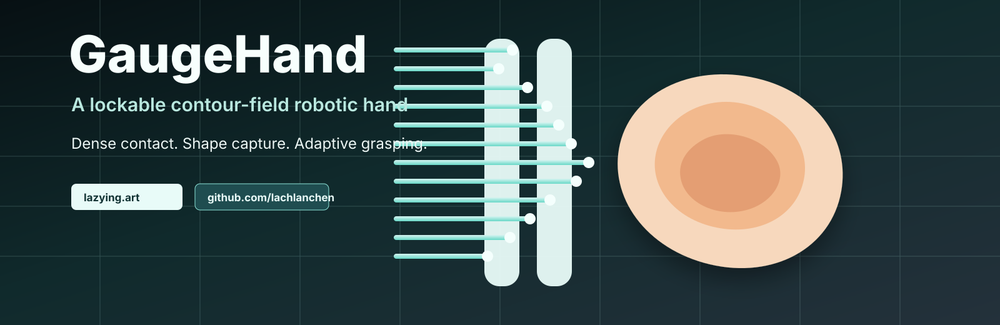

[English](https://github.com/lachlanchen/lachlanchen/blob/main/README.md) · [العربية](https://github.com/lachlanchen/lachlanchen/blob/main/i18n/README.ar.md) · [Español](https://github.com/lachlanchen/lachlanchen/blob/main/i18n/README.es.md) · [Français](https://github.com/lachlanchen/lachlanchen/blob/main/i18n/README.fr.md) · [日本語](https://github.com/lachlanchen/lachlanchen/blob/main/i18n/README.ja.md) · [한국어](https://github.com/lachlanchen/lachlanchen/blob/main/i18n/README.ko.md) · [Tiếng Việt](https://github.com/lachlanchen/lachlanchen/blob/main/i18n/README.vi.md) · [中文 (简体)](https://github.com/lachlanchen/lachlanchen/blob/main/i18n/README.zh-Hans.md) · [中文（繁體）](https://github.com/lachlanchen/lachlanchen/blob/main/i18n/README.zh-Hant.md) · [Deutsch](https://github.com/lachlanchen/lachlanchen/blob/main/i18n/README.de.md) · [Русский](https://github.com/lachlanchen/lachlanchen/blob/main/i18n/README.ru.md)

  

  <a href="../README.md">English</a> · <a href="README.zh-Hans.md">简体中文</a> ·
  <a href="README.zh-Hant.md">繁體中文</a> · <a href="README.ja.md">日本語</a> ·
  <b>한국어</b> · <a href="README.es.md">Español</a> ·
  <a href="README.fr.md">Français</a> · <a href="README.de.md">Deutsch</a> ·
  <a href="README.pt.md">Português</a> · <a href="README.ru.md">Русский</a> ·
  <a href="README.ar.md">العربية</a>

# GaugeHand

**GaugeHand는 [Lachlan Chen](https://github.com/lachlanchen)이 제안한 contour-field 로봇 손 개념이며 [lazying.art](https://lazying.art) 연구 흐름에서 공개됩니다.**

사람 손의 관절을 그대로 복제하는 대신, 많은 단순 접촉 요소로 조밀한 접촉장을 만드는 접근입니다. 물체가 닿으면 핀 배열이 3D contour gauge처럼 형상을 받아들이고, 잠금 구조가 그 형상을 임시 맞춤 지그로 고정합니다.

## 핵심

- 조밀한 접촉은 미지 물체를 더 많이 지지할 수 있습니다.
- 수동 형상 복사만으로는 부족하며 잠금이 필요합니다.
- 핀 변위는 촉각 깊이 맵으로 사용할 수 있습니다.
- 진짜 dexterity에는 전단/횡방향 접촉 제어가 필요합니다.

## 첫 MVP

처음부터 다섯 손가락 손을 만들지 말고, 양면 잠금식 핀 배열 그리퍼부터 만듭니다.

1. 두 개의 작은 pin-array pad를 마주 보게 배치합니다.
2. 각 핀은 수동 슬라이드와 스프링 복귀를 가집니다.
3. 부드러운 실리콘 팁이나 교체 가능한 스킨을 사용합니다.
4. 공유 잠금판으로 획득한 윤곽을 고정합니다.
5. 리니어 슬라이드나 평행 그리퍼로 닫힘 힘을 제공합니다.

## Resources

| File | Content |
| --- | --- |
| [Deep report](../references/contour-field-robotic-hand-report.md) | feasibility, architecture, risks, roadmap |
| [LaTeX paper](../publications/gaugehand_contour_field_feasibility.tex) | detailed publication draft |
| [Commercial baselines](../references/commercial-products-and-baselines.md) | market and product comparisons |
| [Chinese procurement notes](../references/chinese-market-procurement-notes.md) | search terms and buying notes |
| [IDEAS handoff](../references/ideas-codex-handoff.md) | publishing prompt for IDEAS |
| [publish-repo skill](../skills/publish-repo/SKILL.md) | GitHub publishing workflow for Codex / AgInTi |

## Support

[lazying.art](https://lazying.art) 또는 [GitHub Sponsors](https://github.com/sponsors/lachlanchen)를 통해 공개 연구 노트를 지원할 수 있습니다.

| Donate | PayPal | Stripe |
| --- | --- | --- |
|  |  |  |
